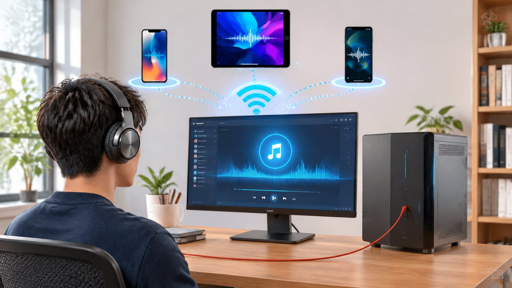
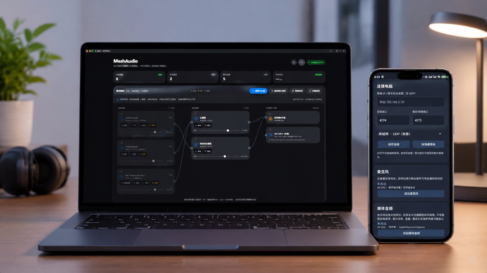
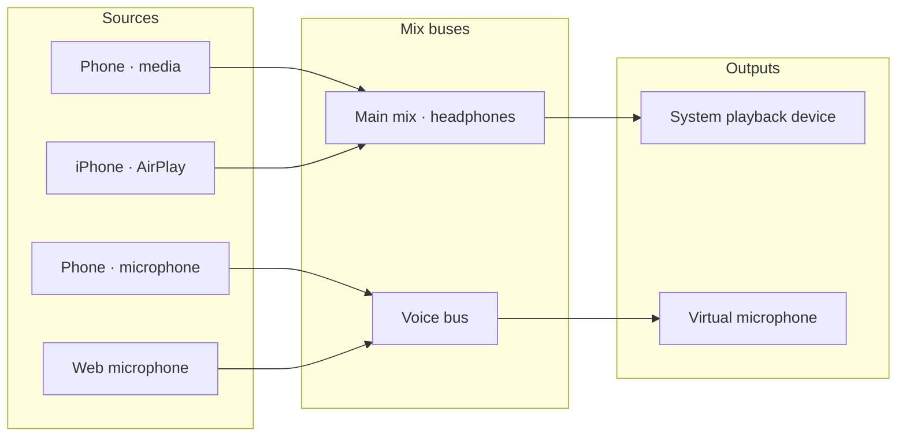

<div align="center">


# MeshAudio · LAN Audio Routing

**Send your phone's sound wherever you want it to go**

[](LICENSE)


[](https://tauri.app/)
[](https://vuejs.org/)
[](https://www.rust-lang.org/)
[](https://nodejs.org/)

[Download and install](#download-and-install) · [Core capabilities](#core-capabilities) · [How it works](#how-it-works) · [Tech stack](#tech-stack) · [Build from source](#build-from-source) · [FAQ](#faq) · [Contributing](#contributing)

[简体中文](README.md) · **English**

</div>

---

## Why I built this

I've been playing *Delta Force* lately. Anyone who has fought the last squad knows the final minutes are usually spent lying in the grass, waiting — so I hold an angle with one hand and scroll short videos on my phone with the other. Game audio on the PC, video audio on the phone, two headsets stacked on my head: miserable.

I own a lot of devices, and I wanted one very unglamorous feature: **every device's audio in the same pair of headphones, at the same time**. A SteelSeries headset used to handle it — three devices at once — until it died. The replacements that can mix multiple inputs cost more than I was willing to spend.

So I wrote one: pull each device's audio into the PC, then decide where it goes. That is MeshAudio.

When I added up the bill afterwards, the tokens had cost about as much as a new headset :(

## Preview

<p align="center"></p>

<p align="center"><sub>Illustration: phone, tablet and PC connect independently, merge into the same routing graph, and end up in the headset you are wearing.</sub></p>

<p align="center"></p>

<p align="center"><sub>The desktop canvas and the phone page: the canvas is always Source → Mix bus → Output; on the phone you can leave the address empty to auto-discover, and start microphone and media audio separately.</sub></p>

## What it is

MeshAudio is a **LAN audio routing tool for Windows**. To MeshAudio, the sound your phone is playing and the audio from your phone's microphone are two **independent** sources. You drag a few cables on a fixed three-column canvas and decide where each one goes: into your headphones, into your PC as a microphone for a meeting app, or mixed together.

- **Two independent paths**: media audio and microphone are separate streams with separate start/stop; stopping one never affects the other.
- **Canvas routing**: source → mix bus → output. Sources can fan out, buses can be mixed down, and rewiring takes effect immediately.
- **Nothing breaks**: a phone going offline just greys out its source and keeps every cable; it reconnects on its own while the other paths keep playing.
- **Several entry points**: a native Android app, AirPlay from an iPhone, and a browser-based web microphone can all act as sources.

The desktop side only receives, mixes and outputs. It **does not record what your PC is playing, does not take exclusive control of your speakers, and does not replace the Windows volume mixer**.

> **Project status**: the current version is **0.3.1 (acceptance candidate / pre-release)**. Core paths work on real devices and in the packaged app, but the gates for a clean Windows install/uninstall, iPhone AAC-ELD plus headphone listening, and 30-minute continuous playback have **not passed yet**. Everything still open is listed in [Known limitations](docs/KNOWN-LIMITATIONS.md) (Chinese). Treat it as a trial build, not a production-stable release.

**Contents**: [Why I built this](#why-i-built-this) · [Preview](#preview) · [What it does](#what-it-does) · [Download and install](#download-and-install) · [Your first patch](#your-first-patch) · [Connecting devices](#connecting-devices) · [Core capabilities](#core-capabilities) · [How it works](#how-it-works) · [Tech stack](#tech-stack) · [Project layout](#project-layout) · [Build from source](#build-from-source) · [FAQ](#faq) · [Scope and limitations](#scope-and-known-limitations) · [Contributing](#contributing) · [License](#license)

## What it does



Two typical setups:

- **Phone sound → headphones**: connect the "media" source to the "main mix" bus, then connect that bus to a system playback device.
- **Phone microphone → PC microphone**: connect the "microphone" source to another bus, then to a virtual input; pick `CABLE Output` in WeChat, Zoom or any meeting app. The two setups do not interfere.

## Download and install

### Download

Grab the files from **[Releases → v0.3.1](https://github.com/kingyxs/MeshAudio/releases/tag/v0.3.1)** in this repository:

| File | Purpose |
| --- | --- |
| `MeshAudio_0.3.1_x64-setup.exe` | Windows 10/11 x64 installer |
| `MeshAudio-Android-0.3.1-release.apk` | Android node (signed, Android 10+) |
| `MeshAudio-0.3.1-source.zip` | Project source (GPL requires it alongside the binaries) |
| `MeshAudio-0.3.1-third-party-sources.tar.gz` | Complete corresponding source for third-party components |
| `SHA256SUMS.txt` | SHA-256 checksums for the files above |

### Verify

Compare the checksum after downloading to confirm the file is intact and genuine:

```powershell
Get-FileHash .\MeshAudio_0.3.1_x64-setup.exe -Algorithm SHA256
```

Match the output against the corresponding line in `SHA256SUMS.txt`. The installer is **not signed with a commercial code-signing certificate**, so Windows SmartScreen may warn about an unknown publisher; confirm the download came from this repository's Release and that the checksum matches before running it.

### Install (Windows)

1. Run `MeshAudio_0.3.1_x64-setup.exe`. Node, Rust and build tools are not required; if WebView2 is missing the installer fetches it online. The app installs into your user directory by default.
2. The first launch shows a setup guide. Pick the components you need and select "Install selected components":
   - **Bonjour / AirPlay**: tick this if you want to receive AirPlay from an iPhone.
   - **VB-CABLE virtual audio device**: tick this if you want to feed audio into a meeting app as a microphone.
   - For playback and basic routing only, **you need neither**.
3. Components are downloaded from their vendors, verified, then installed by the official installers. Expect admin prompts and licence dialogs; a driver install may require a **reboot**. Already-installed components are not reinstalled.
4. UxPlay (the AirPlay receiver) ships with the app and is deployed automatically — no separate download or build.
5. Closing the main window only hides it to the tray. To quit completely, choose **Quit** from the tray menu.

Configuration lives in `%APPDATA%/com.meshAudio.desktop/` and survives upgrades. Uninstalling the main app does not delete your configuration and does not remove other vendors' drivers or services. Firewall rules, data and uninstall details are in [Windows installation](docs/WINDOWS-INSTALLATION.md) (Chinese).

## Your first patch

The canvas always has three columns: **source → mix bus → output**.

1. Once a phone connects, its source cards appear in column one (media and microphone separately).
2. Create a bus in column two, or use the defaults "Main mix · headphones" and "Voice · virtual microphone".
3. **Drag from the round port on a source card onto a bus** and release to connect; then drag the bus onto an output in column three. Preview lines and highlights show what can connect where.
4. Sources cannot connect straight to outputs — mixing has to happen in a bus. Drop on empty space, press `Esc`, or click elsewhere to cancel. Touch and keyboard (Tab / Enter) work the same way.
5. Click a cable to delete it from the middle of the curve. The wheel scrolls the page by default; click the canvas first to let it take over internal scrolling, then press `Esc` to exit that mode.

A source can feed several buses and a bus can sum several sources. Set a bus gain to zero, mute it, or leave it unconnected and it simply goes silent.

## Connecting devices

### Android (recommended, most complete)

1. Install `MeshAudio-Android-0.3.1-release.apk`; Android 10 and above are supported.
2. Put the phone and the PC on the **same trusted LAN** and open the desktop app. Leave the PC address empty in the app to auto-discover, or type the PC's IPv4 address.
3. Tap "Start microphone" and "Start media audio" separately and grant the permissions the system asks for. Media audio has to be confirmed again in every new session — an Android restriction.
4. Both paths appear as two independent sources on the canvas and can be stopped or muted separately. Background capture relies on a foreground service with a persistent notification, which also offers a quick stop.

> If you previously installed the **debug test build**: the release APK uses a different signing key and cannot be installed over it. Uninstall the old build first (this clears app data and requires granting permissions again), or keep using the debug build for development. See the [Android guide](android/README.md) (Chinese).

### iPhone / iPad (AirPlay)

Make sure Bonjour is ready under "Settings → Components", then add and start an AirPlay line on the canvas, and pick the PC manually in Control Center → Screen Mirroring. The QR code only shows connection instructions and **cannot replace the system picker**. The AirPlay receiver has no video window; audio goes through MeshAudio routing.

### Web microphone

If you would rather not install an app, scan the QR code from the desktop app to open the web microphone page. Remote microphone access requires trusted HTTPS; on iOS, locking the screen or switching apps may pause it, so **do not treat it as native background capture**.

## Core capabilities

### 1. Two genuinely independent sources

- The Android app creates two independent `sourceId`s for media audio and microphone, each with its own format, sequence numbers and timestamps;
- The desktop keeps a separate queue and jitter buffer per source, so stopping, disconnecting or muting one never changes the routing or gain of the other;
- When a source goes offline its node and all cables stay, and streaming resumes automatically without rewiring.

### 2. A three-column canvas instead of a pile of dropdowns

- Fixed columns for source → bus → output; cables are the only way to express routing, so you can see at a glance where the signal goes;
- Fan-out and mix-down are supported; sources cannot connect directly to outputs, which prevents bypassing mixing and gain;
- Mouse, touch and keyboard (Tab / Enter) are equivalent, and the canvas scrolls horizontally in narrow windows;
- Rewiring is written to the server state and takes effect immediately — no need to stop devices or restart the app.

### 3. Mixing and two kinds of output

- Every bus has gain, mute and a live level meter; multiple sources on one bus are summed before the bus gain is applied;
- **System playback** uses WASAPI shared mode, so it never takes exclusive control of your speakers and other apps keep playing;
- **Virtual microphone** writes into `CABLE Input` of the VB-CABLE you installed yourself; recording apps read from `CABLE Output`. MeshAudio neither installs nor fakes a driver — if it cannot find one it reports an error instead of pretending to work.

### 4. Link resilience

- Losing the control connection only affects canvas state sync; audio already being received keeps flowing;
- Audio is checked by sequence number, with packet-loss advancement and jitter buffering, so short network hiccups do not collapse a whole path;
- Every adapter must report capabilities and errors: platform limits, missing components and revoked permissions are surfaced rather than silently degraded.

### 5. Several entry points, one canvas

- **Native Android node**: written in Java, with a foreground service and persistent notification; media and microphone start and stop separately;
- **AirPlay**: one process per line (UxPlay), no video window, audio joins the normal source graph;
- **Web microphone**: browser `getUserMedia` plus WebSocket — scan and use, handy for temporary setups.

### 6. Diagnosable

- The canvas header shows online sources, active buses, route count and average latency;
- Source cards show online state, device type, level and measured latency; AirPlay line panels also show the source IP and current route, with actionable hints when something is wrong;
- The server exposes a health check and a state snapshot, which helps answer questions like "the cables look right, why is there no sound".

## How it works

```text
Android / iPhone / browser
        │  UDP 4175 · "MSA1" header + PCM float32 48 kHz
        │  (web microphone uses WebSocket)
        ▼
  per-source queue + jitter buffer (independent per sourceId)
        │
        ▼
  mix bus (gain / mute / level) ── fan-out and mix-down
        │
        ├─→ system playback device (WASAPI shared mode, non-exclusive)
        └─→ VB-CABLE virtual microphone (pick CABLE Output in meeting apps)
```

Layered structure:

```text
Vue 3 three-column canvas (Tauri 2 / WebView2)
      │  HTTP + WebSocket control plane
      ▼
Node.js service server.js
  ├─ routing state model (source / bus / output / route) and persistence
  ├─ UDP discovery, audio receive, level and latency statistics
  ├─ component management (Bonjour / VB-CABLE / UxPlay)
  └─ web microphone gateway
      ▼
native audio engine meshaudio-native.exe (C++20 + WASAPI)
  ├─ per-source queues and mixing
  ├─ system playback endpoint (shared mode)
  └─ virtual microphone endpoint detection and writes
```

| Purpose | Protocol | Default port |
| --- | --- | --- |
| Control plane, state sync | HTTP / WebSocket | `4173/TCP` |
| Web microphone page and audio | HTTP / HTTPS / WebSocket | `4176/TCP`, `4177/TCP` (with a certificate) |
| Device discovery | UDP broadcast JSON | `4174/UDP` |
| Audio frames | UDP (`MSA1` + PCM f32le) | `4175/UDP` |

Protocol details (discovery request, frame header, stream metadata) are in [protocol/README.md](protocol/README.md) (Chinese).

## Tech stack

| Layer | Choice |
| --- | --- |
| Desktop shell | Tauri 2 + Rust (single instance, tray, sidecar lifecycle) |
| UI | Vue 3 · TypeScript · Vite · Pinia (canvas, components, i18n) |
| Control plane | Node.js (HTTP / WebSocket, routing state, discovery, diagnostics) |
| Audio engine | C++20 + WASAPI shared mode (`desktop/native`); a JS engine remains for diagnostics and fallback |
| Transport | Custom protocol v1: UDP audio frames, UDP broadcast discovery, HTTP/WS control |
| Mobile | Native Android (Java, foreground service); iOS via AirPlay (UxPlay + Bonjour) |
| Virtual mic | External VB-CABLE (optional proprietary component, not redistributed) |
| Packaging | NSIS (Windows x64) |

## Project layout

```text
meshAudio/
├─ desktop-app/            Tauri 2 shell + Vue 3 canvas
│  ├─ src/                 pages, components, stores, i18n
│  └─ src-tauri/           Rust shell, icons, capabilities
├─ desktop/                Node audio engine, native bridge, AirPlay manager, web mic gateway
│  └─ native/              C++20 + WASAPI engine and device enumeration
├─ android/                Android native node (Java, foreground service)
├─ protocol/               Shared protocol v1 (discovery / frames / control)
├─ third_party/            UxPlay source snapshot and patches, public headers, dependency locks
├─ tools/                  Build, isolated regression, acceptance and source export scripts
├─ docs/                   Architecture, installation, acceptance, ADRs, licensing, limitations
├─ LICENSES/               Full third-party licence texts
├─ server.js               Control plane and routing state service
├─ browser-node.html/js    Web microphone page
└─ package.json
```

| Module | Responsibility |
| --- | --- |
| `server.js` | Routing state, discovery and audio ingress, component management, HTTP/WS control plane |
| `desktop/audio-engine.js` | Device-agnostic mixing, sequence checks, packet-loss advancement, jitter buffering |
| `desktop/native/` | WASAPI device enumeration, shared-mode playback, virtual microphone writes |
| `desktop-app/` | Three-column canvas, settings and guide, Tauri lifecycle and tray |
| `android/` | Dual-stream capture (media and microphone), discovery, foreground service and notification |
| `tools/` | Native/AirPlay/Android builds, protocol and UI tests, release material export |

## Build from source

> Only want to use it? Follow [Download and install](#download-and-install) above; the rest of this section is for developers.

**Requirements**: Windows x64, Node.js 22.12+, Rust stable MSVC, Visual Studio C++ desktop workload and the Windows SDK, CMake. Building AirPlay additionally needs MSYS2 UCRT64 and GStreamer; building Android needs JDK 17 and Android SDK 35.

```powershell
npm ci
npm ci --prefix desktop-app
npm run build:native

# AirPlay (optional, needs MSYS2 and Bonjour)
$env:MESHAUDIO_MSYS2 = 'C:\msys64'
node tools/build-minimal-codecs.js
powershell -ExecutionPolicy Bypass -File tools/build-uxplay.ps1 -MsysRoot $env:MESHAUDIO_MSYS2
node tools/prepare-airplay-sources.js

# Test and package
npm run test:all
npm test --prefix desktop-app
npm run tauri:build --prefix desktop-app -- --bundles nsis
```

- Output lands in `desktop-app/src-tauri/target/release/bundle/nsis/`; the executable must ship together with the generated `resources` directory and cannot be copied out as a portable build.
- Build scripts verify that the native engine, receiver and licence material are present and fail otherwise, so they never produce a package that only looks self-contained.
- The Android node builds separately: run `tools/setup-android.ps1` then `tools/build-android.ps1`; see [android/README.md](android/README.md) (Chinese).

Full dependency, mirror and troubleshooting notes are in [Building from public source](docs/PUBLIC-BUILD.md) (Chinese).

## FAQ

| Symptom | Check first |
| --- | --- |
| Cables are connected but there is no sound | Is the bus gain above zero, is it muted, is the source online, is the bus connected to an output? |
| The virtual microphone stays silent | Is VB-CABLE installed and detected? The recording app must select `CABLE Output` (MeshAudio writes to `CABLE Input`) |
| The phone cannot find the PC | Same subnet? Firewall allows `4173/TCP` and `4174-4175/UDP` (plus `4176-4177/TCP` for the web microphone)? Guest network, AP isolation or "public network" profile? You can type the PC's IPv4 in the app |
| iPhone will not connect | Did you pick the receiver manually in Control Center? Is Bonjour installed and running? |
| A source turned grey | The phone disconnected or stopped streaming — normal. Cables are kept and it returns automatically |
| "Unknown publisher" warning | The installer is not commercially code-signed; verify against `SHA256SUMS.txt` and continue |
| Settings disappeared after an upgrade | Configuration lives in `%APPDATA%/com.meshAudio.desktop/`; quit via the tray menu, and note that uninstalling the main app keeps your settings |
| Is macOS supported? | No. The current scope is Windows 10/11 desktop plus Android/AirPlay/web sources |

## Scope and known limitations

- This project assumes a **trusted LAN**. The audio and control protocols have no encryption or authentication; do not expose the control interface to the internet and do not use it on guest networks.
- VB-CABLE and Apple Bonjour are **optional proprietary components that are not redistributed here**. Only when you select them does the app download them from the vendor and run the official installer; their licences and terms are the vendors'.
- The virtual microphone currently depends on external VB-CABLE; MeshAudio's own kernel virtual device has not shipped, and neither has a native iOS app or background capture extension.
- This is a pre-release: clean-Windows install/uninstall, real-iPhone AAC-ELD and headphone listening, two concurrent devices, 30 minutes of continuous playback and a historical audio jump issue have **not been accepted yet**. See [Known limitations](docs/KNOWN-LIMITATIONS.md) and the [acceptance record](docs/ACCEPTANCE-0.3.1.md) (both Chinese); please do not treat these as done.

## Documentation map

All design and acceptance documents below are currently written in Chinese; English translations are welcome.

| Document | Contents |
| --- | --- |
| [Project overview](docs/PROJECT-OVERVIEW.md) | Positioning, architecture, protocol, feature list, release status and roadmap |
| [Windows installation](docs/WINDOWS-INSTALLATION.md) | Install, components, firewall, data and uninstall |
| [Building from public source](docs/PUBLIC-BUILD.md) | Dependencies, build order, tests and artifacts |
| [Architecture](docs/ARCHITECTURE.md) | Layers, data flow and replaceable boundaries |
| [Android guide](android/README.md) | Build, signing, permissions and on-device behaviour |
| [Shared protocol v1](protocol/README.md) | Discovery, frame format and control messages |
| [Known limitations](docs/KNOWN-LIMITATIONS.md) | What is missing and what has not been accepted |
| [Acceptance 0.3.1](docs/ACCEPTANCE-0.3.1.md) · [Android acceptance](docs/ACCEPTANCE-ANDROID-0.3.1.md) | Measured evidence and its boundaries |
| [Licensing](docs/LICENSING.md) · [Third-party notices](THIRD-PARTY-NOTICES.md) | GPL obligations, third-party licences and corresponding source |
| [Security](SECURITY.md) | Private reporting channel and support scope |

## Contributing

Issues, pull requests and design discussions are welcome. Please read [CONTRIBUTING.md](CONTRIBUTING.md) first (Chinese): it covers branch conventions, test commands, SPDX header rules and what must not be committed.

First-time contributors need to sign the [Contributor Licence Agreement](CLA.md): tick the box in the pull request and submit a signed record as described in [contributors/README.md](contributors/README.md) (Chinese). The CLA only grants the rights needed to distribute under `GPL-3.0-or-later`; it is **not a copyright assignment** and does not reduce any right downstream users have under the GPL.

Report security issues through the private channel in [SECURITY.md](SECURITY.md); never paste credentials, internal addresses or unredacted logs into a public issue.

## License

MeshAudio's own code is licensed under the **GNU GPL v3 or later (GPL-3.0-or-later)**. The full terms are in [LICENSE](LICENSE); SPDX identifiers and obligations are explained in [docs/LICENSING.md](docs/LICENSING.md) (Chinese).

- You may use, modify and redistribute the project, including commercially;
- When distributing binaries you must also provide the **complete corresponding source of the same version**; every Release here ships the project source, the third-party corresponding source and `SHA256SUMS.txt` side by side;
- Dynamically linked LGPL libraries remain replaceable; third-party components, fonts and icons remain the property of their respective owners, see [THIRD-PARTY-NOTICES.md](THIRD-PARTY-NOTICES.md).

## Credits

Thanks to the projects that made MeshAudio possible: [Tauri](https://tauri.app/), [Vue](https://vuejs.org/), [Node.js](https://nodejs.org/), [Rust](https://www.rust-lang.org/), [UxPlay](https://github.com/FDH2/UxPlay), [VB-CABLE](https://vb-audio.com/Cable/), [Bonjour](https://support.apple.com/kb/DL999), [GStreamer](https://gstreamer.freedesktop.org/), [FFmpeg](https://ffmpeg.org/).

---

If this project helps you, a Star ⭐ is appreciated — and feel free to open an issue to share your setup and feedback.
