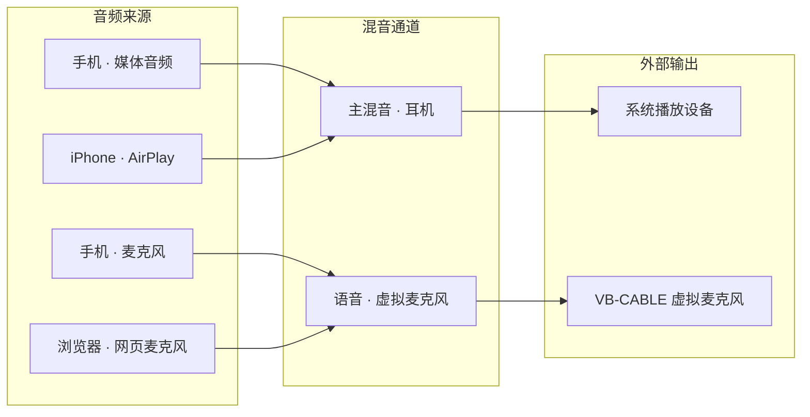

<div align="center">


# MeshAudio · 局域网音频路由

**把手机的声音，接到你想让它去的地方**

[](LICENSE)


[](https://tauri.app/)
[](https://vuejs.org/)
[](https://www.rust-lang.org/)
[](https://nodejs.org/)

[下载与安装](#下载与安装) · [核心能力](#核心能力) · [工作原理](#工作原理) · [技术栈](#技术栈) · [从源码构建](#从源码构建) · [常见问题](#常见问题) · [参与贡献](#参与贡献)

</div>

---

MeshAudio 是一个 **Windows 桌面端的局域网音频路由工具**。手机刷视频的声音、手机的麦克风，在它眼里是两路**互相独立**的音频来源；你在一张固定三列的画布上拖几根线，就能决定每一路去哪里：进耳机、变成电脑上的麦克风给会议软件用、或者几路混在一起。

- **两路独立**：媒体音频与麦克风分别建流、分别启停，一路停掉不影响另一路。
- **画布路由**：音频来源 → 混音通道 → 外部输出，来源可一对多、通道可多对一，改线即时生效。
- **不会打断**：手机掉线只是来源变灰，连线保留；回来自动恢复，其他链路照常播放。
- **多种入口**：Android 原生 App、iPhone 的 AirPlay、电脑浏览器里的网页麦克风都能作为来源。

桌面端只接收、混音和输出，**不录制你电脑正在播放的声音，不独占扬声器，也不替代 Windows 的音量混合器**。

> **项目状态**：当前版本 **0.3.1（验收候选版 / 预发布）**。核心链路已在真机与打包应用上跑通，但干净 Windows 系统的完整安装/卸载、iPhone 的 AAC-ELD 与耳机听感、30 分钟连续播放等门禁**尚未通过**；未完成项逐条列在[已知限制](docs/KNOWN-LIMITATIONS.md)。请按「试用与反馈」使用，不要当作生产稳定版。

**目录**：[它能做什么](#它能做什么) · [下载与安装](#下载与安装) · [第一次连线](#第一次连线) · [接入设备](#接入设备) · [核心能力](#核心能力) · [工作原理](#工作原理) · [技术栈](#技术栈) · [项目结构](#项目结构) · [从源码构建](#从源码构建) · [常见问题](#常见问题) · [使用边界](#使用边界与已知限制) · [参与贡献](#参与贡献) · [开源许可](#开源许可)

## 它能做什么



两个最典型的用法：

- **手机声音 → 耳机**：把「媒体音频」来源连到「主混音」通道，再连到系统播放设备。
- **手机麦克风 → 电脑麦克风**：把「麦克风」来源连到另一个通道，再连到虚拟输入；微信 / Zoom / 会议软件里选中 `CABLE Output` 即可。两件事互不干扰。

## 下载与安装

### 下载

到本仓库的 **[Releases → v0.3.1](https://github.com/kingyxs/MeshAudio/releases/tag/v0.3.1)** 下载：

| 文件 | 用途 |
| --- | --- |
| `MeshAudio_0.3.1_x64-setup.exe` | Windows 10/11 x64 安装程序 |
| `MeshAudio-Android-0.3.1-release.apk` | Android 节点（已签名，Android 10+） |
| `MeshAudio-0.3.1-source.zip` | 项目源码（GPL 要求随二进制提供） |
| `MeshAudio-0.3.1-third-party-sources.tar.gz` | 第三方组件的完整对应源码 |
| `SHA256SUMS.txt` | 以上文件的 SHA-256 校验值 |

### 校验

下载后建议先比对摘要，确认文件完整、来源正确：

```powershell
Get-FileHash .\MeshAudio_0.3.1_x64-setup.exe -Algorithm SHA256
```

把输出与 `SHA256SUMS.txt` 中对应行对比即可。安装包目前**没有购买商业代码签名证书**，Windows SmartScreen 可能提示「未知发布者」；请确认下载自本仓库 Release 且摘要一致后再运行。

### 安装（Windows）

1. 运行 `MeshAudio_0.3.1_x64-setup.exe`。不需要预装 Node、Rust 或开发工具；缺少 WebView2 时安装器会联网获取，安装位置默认在当前用户目录。
2. 首次打开会出现引导，勾选需要的组件后点「安装所选组件」：
   - **Bonjour / AirPlay**：想接 iPhone 的 AirPlay 时勾选；
   - **VB-CABLE 虚拟音频设备**：想把声音送进会议软件当麦克风时勾选；
   - 只听声音、只做基础路由，**两者都不需要**。
3. 组件由应用从原厂下载、校验后调用官方安装器；可能弹出管理员确认、许可点击，驱动安装后可能需要**重启**。已装好的组件不会重复安装。
4. UxPlay（AirPlay 接收器）随主程序自动部署，不需要单独下载或编译。
5. 关闭主窗口只是隐藏到托盘，要彻底退出请从**托盘菜单选「退出」**。

配置保存在 `%APPDATA%/com.meshAudio.desktop/`，升级保留；卸载主程序不会清除配置，也不会卸载其他厂商的驱动或服务。防火墙、数据与卸载的完整说明见 [Windows 安装与首次使用](docs/WINDOWS-INSTALLATION.md)。

## 第一次连线

画布固定三列：**音频来源 → 混音通道 → 外部输出**。

1. 手机接入后，第一列会出现带设备名的来源卡片（媒体 / 麦克风分开）。
2. 在第二列新建通道，或直接用默认的「主混音 · 耳机」「语音 · 虚拟麦克风」。
3. **按住来源卡片上的圆形端口拖到通道**，松开即连上；再把通道拖到第三列的输出。预览线和高亮会告诉你哪里能连、哪里不能连。
4. 来源不能直连输出（混音必须发生在通道里）；拖到空白处、按 `Esc` 或点击别处可以取消。也支持触控和键盘（Tab / Enter）。
5. 点击连线可以在曲线中间删除它；滚轮默认滚动页面，点击画布后才会接管画布内部滚动，再按 `Esc` 退出。

来源可一对多、通道可多对一。通道增益调成 0、静音、或没有连到任何输出时，自然就没有声音。

## 接入设备

### Android（推荐，功能最完整）

1. 安装 `MeshAudio-Android-0.3.1-release.apk`，支持 Android 10 及以上。
2. 手机和电脑连到**同一个可信局域网**，打开桌面端；App 里电脑地址留空即可自动发现，也可手动填电脑的 IPv4。
3. 分别点「启动麦克风」和「启动媒体音频」，按系统提示授权。媒体音频每次新会话都要重新确认，这是 Android 的限制。
4. 两路会作为两个独立来源出现在画布上，可分别停止、静音。后台采集靠前台服务与常驻通知，通知里也能快速停止。

> 如果你之前装过本项目的 **debug 测试包**：release 包签名不同，不能直接覆盖安装。需要先卸载旧包（会清除应用数据并重新授权），或继续用 debug 包做开发测试。详见 [Android 指南](android/README.md)。

### iPhone / iPad（AirPlay）

在「设置 → 组件」确认 Bonjour 已就绪，然后在画布添加并启动 AirPlay 线路，再到 iPhone 控制中心的「屏幕镜像」里手动选择电脑。二维码只显示连接说明，**不能代替系统选择器**。AirPlay 接收器没有视频窗口，音频会经过 MeshAudio 路由。

### 网页麦克风

不想装 App 时，可用桌面端提供的二维码打开网页麦克风页面。远程麦克风权限需要可信 HTTPS；iOS 上锁屏或切到后台可能暂停，**不能当作原生后台采集**使用。

## 核心能力

### 1. 两路真正独立的来源

- Android 端把「媒体音频」和「麦克风」建成两个独立 `sourceId`，各自声明格式、序号与时间戳；
- 桌面端按来源维护独立队列与抖动缓冲，一路停止、掉线或被静音，不会改变另一路的路由和音量；
- 来源离线时保留节点与全部连线，恢复推流后自动继续，不需要重新连线。

### 2. 三列画布，而不是一堆下拉框

- 固定「来源 → 通道 → 输出」三列，连线是唯一的路由表达方式，一眼能看懂信号去了哪里；
- 支持一对多扇出与多对一混音；禁止来源直连输出，避免绕过混音与增益；
- 鼠标、触控、键盘（Tab / Enter）三种操作方式等价，窄窗口下画布可横向滚动；
- 改线立即写入服务端状态并生效，不需要停止设备或重启应用。

### 3. 混音与两种输出

- 每个通道带增益、静音与实时电平；同一通道的多路来源相加后再应用通道增益；
- **系统播放**走 WASAPI 共享模式，不独占扬声器，其他程序照常出声；
- **虚拟麦克风**写入用户自行安装的 VB-CABLE 的 `CABLE Input`，录音应用从 `CABLE Output` 读取；MeshAudio 不安装、不伪造驱动，检测不到就明确报错而不是假装成功。

### 4. 链路韧性

- 控制面断开只影响画布状态同步，已经建立的音频接收不会停；
- 音频按序号检查、丢包推进与抖动缓冲处理，短时网络抖动不会让整条链路崩掉；
- 所有适配器必须报告能力与错误：平台限制、组件缺失、授权被撤销都会显示出来，而不是静默降级。

### 5. 多入口，同一张画布

- **Android 原生节点**：Java 实现，前台服务常驻通知，媒体与麦克风分别启停；
- **AirPlay**：每条线路独立进程（UxPlay），无视频窗口，音频进入普通来源图；
- **网页麦克风**：浏览器 `getUserMedia` + WebSocket，扫码即用，适合临时接入。

### 6. 可诊断

- 画布顶部显示在线来源、活动通道、路由连接数与平均延迟；
- 来源卡片显示在线状态、设备类型、电平与实测延迟；AirPlay 线路面板还会显示来源 IP 与当前路由；异常时给出可执行的提示。
- 服务端提供健康检查与状态快照，便于排查「连好线却没声音」这类问题。

## 工作原理

```text
Android / iPhone / 浏览器
        │  UDP 4175 · "MSA1" 头 + PCM float32 48 kHz
        │  （网页麦克风走 WebSocket）
        ▼
  来源队列 + 抖动缓冲（按 sourceId 独立）
        │
        ▼
  混音通道（增益 / 静音 / 电平）── 一对多、多对一
        │
        ├─→ 系统播放设备（WASAPI 共享模式，不独占）
        └─→ VB-CABLE 虚拟麦克风（会议软件选 CABLE Output）
```

分层结构：

```text
Vue 3 三列画布（Tauri 2 / WebView2）
      │  HTTP + WebSocket 控制面
      ▼
Node.js 服务 server.js
  ├─ 路由状态模型（source / bus / output / route）与持久化
  ├─ UDP 发现、音频接收、电平与延迟统计
  ├─ 组件管理（Bonjour / VB-CABLE / UxPlay）
  └─ 网页麦克风网关
      ▼
原生音频引擎 meshaudio-native.exe（C++20 + WASAPI）
  ├─ 每来源队列与混音
  ├─ 系统播放端点（共享模式）
  └─ 虚拟麦克风端点检测与写入
```

| 用途 | 协议 | 默认端口 |
| --- | --- | --- |
| 控制面、状态同步 | HTTP / WebSocket | `4173/TCP` |
| 网页麦克风页面与音频 | HTTP / HTTPS / WebSocket | `4176/TCP`、`4177/TCP`（配置证书后） |
| 设备发现 | UDP 广播 JSON | `4174/UDP` |
| 音频帧 | UDP（`MSA1` + PCM f32le） | `4175/UDP` |

协议细节（发现请求、帧头、流元数据）见 [protocol/README.md](protocol/README.md)。

## 技术栈

| 层 | 选型 |
| --- | --- |
| 桌面外壳 | Tauri 2 + Rust（单实例、托盘、随包服务生命周期） |
| 界面 | Vue 3 · TypeScript · Vite · Pinia（三列画布、组件、i18n） |
| 控制面 | Node.js（HTTP / WebSocket、路由状态、设备发现、诊断） |
| 音频引擎 | C++20 + WASAPI 共享模式（`desktop/native`）；JS 引擎保留诊断与降级路径 |
| 传输 | 自定义协议 v1：UDP 音频帧、UDP 广播发现、HTTP/WS 控制 |
| 移动端 | Android 原生（Java，前台服务）；iOS 经 AirPlay（UxPlay + Bonjour） |
| 虚拟麦克风 | 外部 VB-CABLE（可选专有组件，不随包分发） |
| 打包 | NSIS（Windows x64） |

## 项目结构

```text
meshAudio/
├─ desktop-app/            Tauri 2 外壳 + Vue 3 画布
│  ├─ src/                 页面、组件、stores、i18n
│  └─ src-tauri/           Rust 壳、图标、capabilities
├─ desktop/                Node 音频引擎、原生桥、AirPlay 管理、网页麦克风网关
│  └─ native/              C++20 + WASAPI 原生引擎与设备枚举
├─ android/                Android 原生节点（Java，前台服务）
├─ protocol/               共享协议 v1（发现 / 音频帧 / 控制）
├─ third_party/            UxPlay 等第三方源码与公开头文件
├─ tools/                  构建、测试、验收与源码导出脚本
├─ docs/                   架构、安装、验收、ADR、许可与已知限制
├─ LICENSES/               第三方许可全文
├─ server.js               控制面与路由状态服务
├─ browser-node.html/js    网页麦克风页面
└─ package.json
```

| 模块 | 职责 |
| --- | --- |
| `server.js` | 路由状态、发现与音频入口、组件管理、HTTP/WS 控制面 |
| `desktop/audio-engine.js` | 设备无关的混音、序号检查、丢包推进与抖动缓冲 |
| `desktop/native/` | WASAPI 设备枚举、共享模式播放、虚拟麦克风写入 |
| `desktop-app/` | 三列画布、设置与引导、Tauri 生命周期与托盘 |
| `android/` | 媒体与麦克风双流采集、发现、前台服务与通知 |
| `tools/` | 原生/AirPlay/Android 构建、协议与 UI 测试、导出发布材料 |

## 从源码构建

> 只想安装使用？直接看上面的[下载与安装](#下载与安装)即可，以下为开发者步骤。

**环境要求**：Windows x64、Node.js 22.12+、Rust stable MSVC、Visual Studio C++ 桌面开发工具与 Windows SDK、CMake。构建 AirPlay 还需要 MSYS2 UCRT64 与 GStreamer 等依赖；构建 Android 需要 JDK 17 与 Android SDK 35。

```powershell
npm ci
npm ci --prefix desktop-app
npm run build:native

# AirPlay（可选，需要 MSYS2 与 Bonjour）
$env:MESHAUDIO_MSYS2 = 'C:\msys64'
node tools/build-minimal-codecs.js
powershell -ExecutionPolicy Bypass -File tools/build-uxplay.ps1 -MsysRoot $env:MESHAUDIO_MSYS2
node tools/prepare-airplay-sources.js

# 测试与打包
npm run test:all
npm test --prefix desktop-app
npm run tauri:build --prefix desktop-app -- --bundles nsis
```

- 产物在 `desktop-app/src-tauri/target/release/bundle/nsis/`；主程序必须与生成的 `resources` 目录一起使用，不能单独复制 exe 当便携版。
- 构建脚本会校验原生引擎、接收器与许可证材料是否齐全，缺失时直接失败，不会生成「看起来自包含」的包。
- Android 节点可单独构建：`tools/setup-android.ps1` 后执行 `tools/build-android.ps1`，详见 [android/README.md](android/README.md)。

完整的依赖、镜像与排错说明见 [从公开源码构建](docs/PUBLIC-BUILD.md)。

## 常见问题

| 现象 | 先检查 |
| --- | --- |
| 连好线却没声音 | 通道音量是否 > 0、是否静音、来源是否在线、通道是否连到了输出 |
| 虚拟麦克风没声音 | 是否安装并检测到 VB-CABLE；录音应用应选择 `CABLE Output`（程序写入的是 `CABLE Input`） |
| 手机发现不了电脑 | 是否同一网段、防火墙是否放行 `4173/TCP` 与 `4174-4175/UDP`（用网页麦克风再加 `4176-4177/TCP`）、是否访客网络 / AP 隔离 / 公共网络；App 里可手动填电脑 IPv4 |
| iPhone 连不上 | 控制中心是否已手动选择接收端、Bonjour 是否安装并运行 |
| 来源变灰了 | 手机掉线或停止推流属正常；连线会保留，恢复后自动回来 |
| 提示「未知发布者」 | 安装包未做商业代码签名，核对 `SHA256SUMS.txt` 后可继续 |
| 升级后设置不见了 | 配置保存在 `%APPDATA%/com.meshAudio.desktop/`；普通退出请用托盘菜单，卸载主程序不会删除配置 |
| 支持 macOS 吗 | 不支持。当前产品范围只有 Windows 10/11 桌面端 + Android/AirPlay/网页来源 |

## 使用边界与已知限制

- 本项目用于**可信局域网**。音频与控制协议没有加密和身份认证，不要把控制接口暴露到公网，也不要在访客网络里使用。
- VB-CABLE、Apple Bonjour 是**可选专有组件，不随本项目分发**：只在你选择后由应用从原厂下载并执行官方安装器，其许可与安装条款以原厂为准。
- 虚拟麦克风目前依赖外部 VB-CABLE，MeshAudio 自有内核虚拟设备尚未交付；iOS 原生 App / 后台采集扩展也未交付。
- 这是预发布版本：干净 Windows 系统的完整安装/卸载、真实 iPhone 的 AAC-ELD 与耳机听感、两台设备并发、30 分钟连续播放、历史音频跳变问题等**还未验收通过**。详见 [已知限制](docs/KNOWN-LIMITATIONS.md) 与[验收记录](docs/ACCEPTANCE-0.3.1.md)，请不要把这些项目当作已完成。

## 文档地图

| 文档 | 内容 |
| --- | --- |
| [完整项目说明](docs/PROJECT-OVERVIEW.md) | 定位、架构、协议、功能清单、版本状态与路线图 |
| [Windows 安装与首次使用](docs/WINDOWS-INSTALLATION.md) | 安装、组件、防火墙、数据与卸载 |
| [从公开源码构建](docs/PUBLIC-BUILD.md) | 依赖、构建顺序、测试与产物 |
| [技术方案](docs/ARCHITECTURE.md) | 分层、数据流与可替换边界 |
| [Android 指南](android/README.md) | 构建、签名、权限与真机行为 |
| [共享协议 v1](protocol/README.md) | 发现、帧格式与控制消息 |
| [已知限制](docs/KNOWN-LIMITATIONS.md) | 尚未交付与尚未验收的项目 |
| [验收记录 0.3.1](docs/ACCEPTANCE-0.3.1.md) · [Android 验收](docs/ACCEPTANCE-ANDROID-0.3.1.md) | 实测证据与边界 |
| [许可说明](docs/LICENSING.md) · [第三方通知](THIRD-PARTY-NOTICES.md) | GPL 义务、第三方许可与对应源码 |
| [安全说明](SECURITY.md) | 私有报告渠道与支持范围 |

## 参与贡献

欢迎 Issue、PR 与设计讨论。提交前请先读 [CONTRIBUTING.md](CONTRIBUTING.md)，其中包含分支约定、测试命令、SPDX 头规范与不得提交的内容。

首次贡献需要签署 [贡献者许可协议（CLA）](CLA.md)：在 PR 中勾选确认，并按 [contributors/README.md](contributors/README.md) 提交签署记录。CLA 只授予按 `GPL-3.0-or-later` 分发所需的权利，**不是版权转让**，也不会减少下游用户依 GPL 享有的任何权利。

安全漏洞请按 [SECURITY.md](SECURITY.md) 使用私有渠道报告，不要在公开 Issue 里贴凭证、内网地址或未经脱敏的日志。

## 开源许可

MeshAudio 自有代码采用 **GNU GPL v3 或更新版本（GPL-3.0-or-later）**，完整条款见 [LICENSE](LICENSE)，SPDX 标识与义务说明见 [docs/LICENSING.md](docs/LICENSING.md)。

- 你可以自由使用、修改、分发本项目，也可以商用；
- 分发二进制时，必须同时提供**同版本的完整对应源码**；本仓库每个 Release 都并列提供项目源码、第三方对应源码与 `SHA256SUMS.txt`；
- 动态链接的 LGPL 库保持可替换；第三方组件、字体与图标版权归各自权利人所有，详见 [THIRD-PARTY-NOTICES.md](THIRD-PARTY-NOTICES.md)。

## 致谢

感谢这些项目让 MeshAudio 成为可能：[Tauri](https://tauri.app/)、[Vue](https://vuejs.org/)、[Node.js](https://nodejs.org/)、[Rust](https://www.rust-lang.org/)、[UxPlay](https://github.com/FDH2/UxPlay)、[VB-CABLE](https://vb-audio.com/Cable/)、[Bonjour](https://support.apple.com/kb/DL999)、[GStreamer](https://gstreamer.freedesktop.org/)、[FFmpeg](https://ffmpeg.org/)。

---

如果这个项目对你有帮助，欢迎 Star ⭐、提交 Issue，或在 Issue 中分享你的使用场景与反馈。
